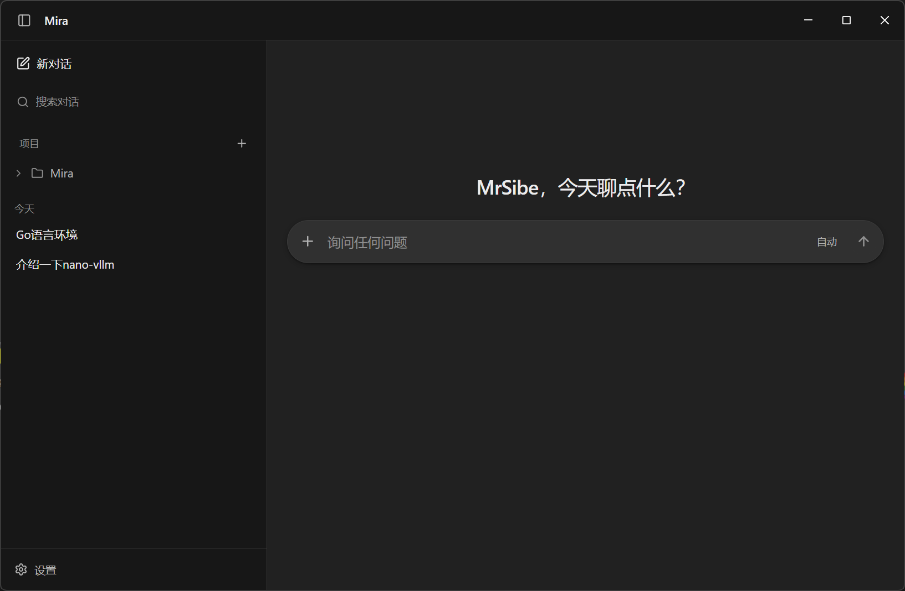

<p align="center">
  
</p>

<h1 align="center">Mira</h1>

<p align="center">
  本地优先的 ChatGPT 桌面客户端
</p>

<p align="center">
  <a href="https://github.com/mrsibe/mira/releases/latest">
    
  </a>
  
  <a href="LICENSE">
    
  </a>
</p>

<p align="center">
  
</p>

Mira 把 ChatGPT 式的对话体验带进 Windows、macOS 和 Linux 桌面，模型由你选择：
接入 OpenAI、Anthropic、Gemini、DeepSeek，或在本机运行 Ollama。对话、项目、
设置和长期记忆保存在本机，模型请求只发送给你配置的服务商。

Mira 本身免费，不需要 ChatGPT 订阅，也不需要注册 Mira 账号。模型费用取决于你
选择的服务商和用量。

## 适合谁

- 想要 ChatGPT 的对话体验，但不想被单一订阅绑定。
- 已经在用 API 或多个服务商的免费额度，需要一个统一的桌面客户端。
- 希望历史、项目和记忆留在本机。

## 下载

前往 [最新 Release](https://github.com/mrsibe/mira/releases/latest) 下载对应平台的版本。

| 平台 | 文件 | 说明 |
| --- | --- | --- |
| Windows 10/11 | `mira-setup-{version}-amd64.exe` | 安装程序，支持自动更新 |
| macOS | `mira-{version}-darwin-arm64.tar.gz` / `mira-{version}-darwin-amd64.tar.gz` | 解压后将 `Mira.app` 移到 `~/Applications` |
| Linux | `mira_{version}_amd64.deb` / `mira-{version}-1.x86_64.rpm` / `mira-{version}-linux-amd64.tar.gz` | Debian / Ubuntu、Fedora / RHEL 或通用归档 |

Windows 安装包、macOS 应用和 Linux 通用归档支持签名自动更新。通过包管理器
安装的版本请随包管理器升级。

<details>
<summary>macOS 首次打开时提示“已损坏”或无法验证？</summary>

Mira 当前没有 Developer ID 签名和公证。把应用放到当前用户可写的目录后执行：

```bash
xattr -dr com.apple.quarantine ~/Applications/Mira.app
```

</details>

## 开始使用

1. 首次打开 Mira，会进入“添加第一个模型”向导。
2. 选择服务商，填写 Base URL、模型名称和 API Key，可以顺便测试连接。
3. 添加后即可开始对话；之后在“设置 → 模型”中新增、编辑或切换模型。

支持 OpenAI、Azure OpenAI、Google Gemini、Anthropic、DeepSeek、OpenRouter、
xAI 和任意 OpenAI 兼容端点。Ollama、LM Studio 等本地无鉴权服务通常不需要填写
API Key。密钥按模型分别保存在系统钥匙串中，不会写入 `config.json`；也可以用
对应服务商的环境变量提供密钥。

模型调用由对应服务商按用量计费。想控制成本，可以先用本地 Ollama，或选择
按量计费的低价模型。

## 功能

### 对话

- 两栏布局、Markdown 回答、代码高亮和流式输出。
- 可保存多个模型条目，在设置中随时切换；新增模型会自动启用。
- 停止生成、复制回答、编辑提问并重新生成，或从任一回答分叉出新对话。
- 每条回答和整个对话都显示 token 用量，包括输入、输出、缓存和推理 token。
- 思考过程折叠为“思考了 Xs”，展开后按时间查看思考、计划和工具调用。
- 在输入框内切换思维强度，最后的选择保存在本机。

### 搜索与记忆

- 联网搜索默认使用 DuckDuckGo，不需要 API Key；可在设置中切换到 Tavily。
- 历史对话通过 BM25 检索，模型需要时可以主动查找相关内容。
- 每累计 8 条用户消息，自动整理一次长期记忆摘要。
- 记忆摘要可以直接查看和编辑，也可以随时清空。

### 智能界面

- 回答可以生成表格、图表、表单等可交互组件，与 Markdown 按原始顺序交错排列。
- 组件只能使用内置目录，不能执行 HTML、JavaScript 或任意 CSS。
- 默认开启，可在“设置 → 个性化”中关闭；关闭后只显示普通 Markdown 回答。

### 个性化

- 调整人格、回答风格、亲切程度、热情程度和 Emoji 频率。
- 设置对话中使用的称呼，以及最多 5000 字的自定义指令。
- 自定义指令会随设置保存在本机，并加入之后每次对话。

### 项目、搜索与外观

- 用项目整理对话，支持新建、重命名、删除，以及拖拽移动到项目。
- 搜索全部历史消息，显示命中角色、上下文片段和关键词，点击结果直接定位。
- 支持浅色、深色和跟随系统主题。
- 界面字体、对话字体、代码字体和字号都可以调整，侧栏宽度可拖拽并记住。

## 数据与隐私

对话、项目和记忆保存在本机；模型请求只发送给你配置的服务商。

- 会话以 JSONL 保存，索引丢失或损坏时会自动重建。
- 模型和搜索密钥优先存入 macOS Keychain、Windows Credential Manager 或
  Linux Secret Service。
- `config.json` 权限为 `0600`，只保存模型连接信息，不包含密钥。
- 目前没有云同步，迁移到新电脑需要手动复制数据目录。

<details>
<summary>数据保存在哪里？</summary>

| 平台 | 路径 |
| --- | --- |
| macOS | `~/Library/Application Support/Mira` |
| Linux | `~/.config/Mira`（遵循 `XDG_CONFIG_HOME`） |
| Windows | `%AppData%\Mira` |

主要文件：

```text
config.json                  # 多模型与界面设置，不含密钥
conversations/index.json     # 会话索引
conversations/<id>.jsonl     # 每个会话的消息与用量
conversations/projects.json  # 项目分类
memory/USER.md               # 自动记忆摘要
memory/state.json            # 摘要时间与待处理轮数
```

</details>

## 开发

需要 Go 1.27.4+、Bun 1.2+，以及对应平台的系统 WebView。

```bash
bun install
bun run dev
```

完整的环境准备、配置、架构、测试和发布流程见
[开发指南](docs/DEVELOPMENT.md)。

## 文档

| 文档 | 内容 |
| --- | --- |
| [开发指南](docs/DEVELOPMENT.md) | 从源码构建、配置、架构、测试与发布 |
| [设计规范](DESIGN.md) | 布局、颜色、排版与交互原则 |
| [更新日志](CHANGELOG.md) | 每个版本的变化 |
| [GitHub Releases](https://github.com/mrsibe/mira/releases) | 安装包与签名更新 |

## License

[MIT](LICENSE) © 2026 MrSibe

Mira 与 OpenAI 无关联。ChatGPT 是 OpenAI 的商标。
